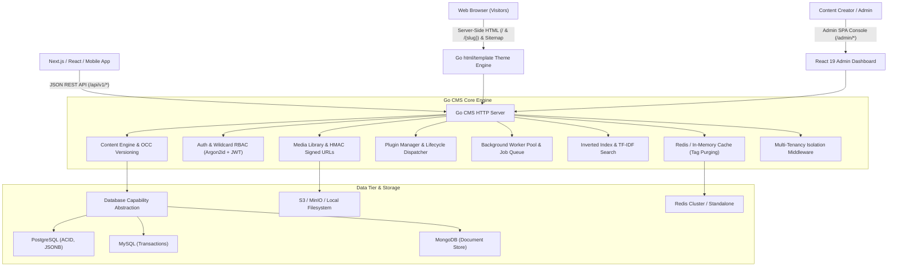

# Go CMS Platform

[](https://golang.org)
[](https://react.dev)
[](https://www.typescriptlang.org)
[](https://tailwindcss.com)
[](https://www.docker.com)
[](LICENSE)

A production-grade, extensible Content Management System (CMS) written in Go.

Go CMS combines the flexible content modeling and headless JSON APIs of modern headless engines (such as Strapi) with traditional, lightning-fast server-rendered HTML websites using Go's standard library `html/template` (WordPress style). It features an enterprise multi-database abstraction layer (PostgreSQL, MySQL, MongoDB), a sandboxed plugin SDK, an integrated React Admin Dashboard, background worker pool, Redis caching, TF-IDF search engine, multi-tenancy, and full Prometheus observability.

---

## Dual Operating Modes

Go CMS is engineered to serve both headless clients and traditional server-rendered websites concurrently from a single core:



---

## Key Features

### 1. Dynamic Content Engine
- **Flexible Content Modeling:** Define **Collection Types** (e.g. Articles, Products) and **Single Types** (e.g. Homepage, Global Settings) on the fly via UI or REST API.
- **18 Built-in Field Types:** `short_text`, `long_text`, `rich_text`, `number`, `decimal`, `boolean`, `date`, `datetime`, `email`, `secret`, `url`, `enum`, `json`, `media`, `relation_single`, `relation_multiple`, `component`, and `uid`.
- **Draft & Publish Workflows:** Clear separation of draft data and published data to prevent premature live changes.
- **Optimistic Concurrency Control (OCC):** Prevents concurrent edit race conditions.
- **Full Version History & Rollback:** Historical snapshots stored on every edit with one-click restoration to any historical version.

### 2. Native Go HTML Template & Theme Engine
- **Strictly Native:** Built 100% on Go standard library `html/template` (no third-party template DSLs).
- **Layouts & Partials:** Inheritance tree (`layouts/base.html`, `partials/header.html`, `partials/footer.html`, `pages/*.html`).
- **Contextual UGC Escaping & Sanitization:** Includes side-effect-free safe template functions and `bluemonday` sanitization.
- **Dynamic Routing & Draft Preview:** Instant draft previewing via `?preview=true` for authorized editors.
- **Automated SEO:** Automatic generation of XML Sitemaps (`/sitemap.xml`) and RSS 2.0 feeds (`/rss.xml`).

### 3. Enterprise Multi-Database Abstraction
- **Capability Matrix:** Explicit runtime capability query prevents unexecutable database commands.
  - **PostgreSQL:** Full ACID, JSONB containment, full-text, transactions.
  - **MySQL:** Transactions, generated columns, index queries.
  - **MongoDB:** Native document storage, aggregation pipelines.
- **Zero-Downtime Migrations:** Embedded migration engine tracking schema updates with rollback capabilities.

### 4. Sandboxed Plugin Architecture & SDK
- **Public Plugin SDK (`pkg/plugin-sdk/`):** Decoupled plugin manifest (`plugin.json`), lifecycle hooks (`OnLoad`, `OnEnable`, `OnDisable`), custom fields, and private subrouters.
- **Dynamic Routing Dispatcher:** Plugin routes automatically activate and deactivate immediately upon state toggle.
- **Reference Plugins Included:**
  - `audit-log`: Captures all entity lifecycle mutations into structured audit logs.
  - `seo-analyzer`: Analyzes content readability, word counts, and metadata scoring.

### 5. Media Library & Storage Providers
- **Pluggable Storage:** Native adapters for Local Filesystem and Amazon S3 / MinIO.
- **HMAC-SHA256 Signed URLs:** Constant-time verification with expiration control for private files.
- **Security & Hygiene:** Automatic filename sanitization, MIME type sniffing, and downscaled thumbnail generation.

### 6. React 19 Admin Dashboard
- **Modern Web Console:** Built with React 19, TypeScript, Vite, and Tailwind CSS.
- **Integrated Views:** Content Manager, Content Type Builder, Media Library, Themes Manager, Plugin Manager, User & Role Manager, and System Status.
- **Decoupled SPA:** Mounted cleanly at `/admin/` with client-side routing fallback.

### 7. Production Hardening, Observability & Disaster Recovery
- **Caching Layer:** Redis and in-memory caches with automatic tag invalidation (`content`, `content:<type>`).
- **Background Worker Pool:** Concurrent workers with exponential backoff retries and delayed jobs.
- **Full-Text Search:** Inverted index with TF-IDF relevance scoring and automatic lifecycle hook synchronization.
- **Prometheus Metrics:** HTTP duration histograms, request rates, DB connection pool stats at `/metrics`.
- **Multi-Tenancy:** Workspace and tenant isolation via `X-Tenant-ID` and domain matching.
- **OpenAPI 3.0 & Swagger UI:** Comprehensive API definition and interactive explorer at `/docs`.
- **Automated Backup & Restore:** Complete disaster recovery scripts for POSIX (`bash`) and Windows (`powershell`).

---

## Architecture Overview

```
Go CMS Repository Layout
├── admin/                      # React 19 + TypeScript + Vite Admin Dashboard SPA
│   ├── src/                    # Components, views, router, and context state
│   └── dist/                   # Production-compiled assets served at /admin/
├── cmd/
│   ├── server/                 # Application server entry point (main.go)
│   └── migrate/                # Standalone database migration CLI
├── deployments/
│   └── prometheus/             # Prometheus scrape configuration
├── docs/                       # Architecture, security, and OpenAPI 3.0 documentation
│   └── openapi.yaml            # OpenAPI 3.0 specification
├── internal/
│   ├── api/                    # HTTP server, Chi routes, and middleware
│   ├── audit/                  # System audit logging engine & REST handlers
│   ├── auth/                   # Argon2id password hashing, JWT, and wildcard RBAC
│   ├── cache/                  # Redis and In-Memory caching with tag-based purging
│   ├── config/                 # YAML and environment variable configuration
│   ├── content/                # Content engine, dynamic schemas, and OCC versioning
│   ├── database/               # Database capability interfaces & driver adapters
│   │   ├── factory/            # DB connection factory
│   │   ├── migrations/         # Unified migration runner
│   │   ├── mongodb/            # MongoDB adapter
│   │   ├── mysql/              # MySQL adapter
│   │   └── postgres/           # PostgreSQL adapter
│   ├── fields/                 # 18 built-in dynamic field types and validators
│   ├── jobs/                   # Background job queue, worker pool, and retry mechanics
│   ├── localization/           # i18n locale registry and translation resolvers
│   ├── media/                  # Media library, processor, and signed URLs
│   ├── metrics/                # Prometheus observability registry and histograms
│   ├── plugins/                # Plugin manager, host adapters, and subrouter
│   ├── search/                 # Inverted index full-text search with TF-IDF scoring
│   ├── storage/                # Local and S3 storage providers
│   ├── templates/              # Native Go html/template renderer and safe functions
│   ├── tenancy/                # Multi-tenancy isolation middleware and models
│   └── themes/                 # Theme directory manager and theme.json parser
├── pkg/
│   └── plugin-sdk/             # Public SDK interfaces and manifest definitions
├── plugins/                    # Reference plugins (audit-log, seo-analyzer)
├── scripts/                    # Disaster recovery backup and restore utilities
├── tests/
│   └── e2e/                    # Multi-step End-to-End integration test suite
├── themes/
│   └── default/                # Default responsive theme (layouts, pages, partials)
├── docker-compose.yml          # Multi-container local production environment
├── Dockerfile                  # Multi-stage production container build
└── Makefile                    # Development and operational tasks
```

---

## Quick Start

### Option A: Complete Docker Compose Stack (Recommended)

Start the full stack (Go CMS, PostgreSQL, MySQL, MongoDB, Redis, MinIO, and Prometheus) with a single command:

```bash
docker compose up -d
```

### Option B: Local Go Development

#### 1. Prerequisites
- **Go 1.24+**
- **Node.js 18+** & **npm** (for building the admin dashboard)
- PostgreSQL (or MySQL / MongoDB) running locally or via Docker

#### 2. Start PostgreSQL & Redis via Docker
```bash
docker compose up -d postgres redis
```

#### 3. Build the Admin Dashboard
```bash
cd admin
npm install
npm run build
cd ..
```

#### 4. Run the Server
```bash
go run ./cmd/server
```

The CMS server will initialize database migrations, seed default roles and admin credentials, and start listening on `http://localhost:8080`.

---

## Default Access & Endpoints

| Service / Interface | URL | Default Credentials | Description |
| :--- | :--- | :--- | :--- |
| **Website Frontend** | `http://localhost:8080/` | Public | Native Go server-rendered HTML theme |
| **Admin Dashboard** | `http://localhost:8080/admin/` | `admin` / `Admin@CMS2026!` | React Single Page Application console |
| **Swagger UI Docs** | `http://localhost:8080/docs` | Public | Interactive OpenAPI 3.0 documentation |
| **OpenAPI 3.0 Spec**| `http://localhost:8080/api/v1/openapi.yaml` | Public | Raw OpenAPI specification file |
| **Prometheus Metrics**| `http://localhost:8080/metrics` | Public | Prometheus histogram and counter metrics |
| **Health Check** | `http://localhost:8080/healthz` | Public | Liveness probe endpoint |
| **Readiness Check** | `http://localhost:8080/readyz` | Public | Readiness probe (verifies DB ping) |
| **System Info** | `http://localhost:8080/info` | Public | Build version, environment, and DB driver |

---

## Disaster Recovery & Backup

The `scripts/` directory provides automated disaster recovery backup and restore scripts with SHA-256 integrity verification.

### POSIX (Linux / macOS / Git Bash)
```bash
# Create timestamped backup archive with database dump and media uploads
./scripts/backup.sh ./backups

# Restore from backup archive
./scripts/restore.sh ./backups/cms_backup_20261109_120000.tar.gz
```

### Windows PowerShell
```powershell
# Create timestamped backup archive
.\scripts\backup.ps1 -BackupDir .\backups

# Restore from backup archive
.\scripts\restore.ps1 -Archive .\backups\cms_backup_20261109_120000.zip -Force
```

---

## Running Automated Tests

Run the complete test suite across all packages (100% pass rate guaranteed):

```bash
# Run all unit and integration tests
go test -v ./...

# Run the End-to-End (E2E) integration test suite
go test -v ./tests/e2e

# Generate test coverage report
make test-coverage
```

---

## Makefile Targets

| Target | Description |
| :--- | :--- |
| `make build` | Builds backend binaries (`bin/cms-server`, `bin/cms-migrate`) |
| `make build-admin` | Compiles the React Admin SPA into `admin/dist` |
| `make test` | Executes all automated unit and integration tests |
| `make test-coverage`| Generates `coverage.html` visual test report |
| `make lint` | Formats code (`go fmt`) and runs static analysis (`go vet`) |
| `make run` | Starts the server locally |
| `make docker-up` | Launches database and infrastructure containers |
| `make docker-down`| Stops all running Docker containers |
| `make backup` | Runs automated backup script |
| `make clean` | Removes build binaries and cached files |

---

## License

This project is licensed under the MIT License - see the [LICENSE](LICENSE) file for details.
