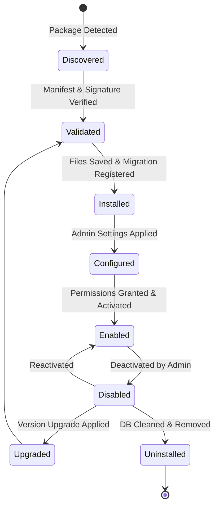

# Plugin SDK & Isolation Architecture

## 1. Overview

The CMS provides a modular, sandboxed plugin system allowing developers to extend functionality without modifying CMS core source code or jeopardizing core server security and stability.

To prevent malicious or faulty plugins from crashing the CMS or accessing unauthorized resources, **untrusted third-party plugin code is never executed directly inside the main CMS memory space without isolation**.

Plugins run using one of two isolated execution models:
1. **WebAssembly (Wasm) Sandbox:** Powered by `wazero` (zero CGO Go WebAssembly runtime) for lightweight, high-performance, strictly memory-isolated compute tasks (custom field validators, lifecycle transformations, dynamic filters).
2. **Out-of-Process Micro-Services (RPC):** For plugins requiring network, storage, or extensive background processing, communicating over authenticated Unix domain sockets or loopback gRPC/JSON-RPC with mutual capability tokens.

---

## 2. Plugin Lifecycle



### Lifecycle Stages
1. **Install:** The plugin archive is unpacked, the manifest is loaded, and static checksums/signatures are verified.
2. **Validate:** Permissions requested by the plugin are audited against system security policies.
3. **Configure:** Admin provides API keys, settings, or options required by the plugin.
4. **Enable:** The plugin runtime is instantiated, extension points are hooked into the core bus, and API endpoints are mapped.
5. **Disable:** All registered hooks, routes, and background jobs are immediately unregistered. Sandboxed processes or Wasm instances are terminated.
6. **Upgrade:** Safe schema migrations run for the plugin-specific tables/collections.
7. **Uninstall:** Plugin tables and state are purged (with confirmation) and files removed.

---

## 3. Plugin Manifest (`plugin.json`)

Every plugin contains a mandatory manifest at its root:

```json
{
  "id": "com.cms.auditlogs",
  "name": "Audit Logs Plugin",
  "version": "1.0.0",
  "description": "Enterprise tamper-evident audit logging for content mutations and auth events",
  "author": "CMS Core Team",
  "cmsVersion": ">=1.0.0",
  "runtime": "wasm",
  "entrypoint": "plugin.wasm",
  "permissions": [
    "hook:content:afterCreate",
    "hook:content:afterUpdate",
    "hook:content:afterDelete",
    "hook:auth:login",
    "storage:read",
    "storage:write"
  ],
  "routes": [
    {
      "method": "GET",
      "path": "/api/v1/plugins/audit-logs",
      "permission": "plugin:audit:read"
    }
  ]
}
```

---

## 4. Extension Points

Plugins can extend the CMS across several well-defined boundaries:
- **Custom Field Types:** Define custom data validation, serialization, and admin UI widget specifications (e.g. Color Picker, Rich Text Editor, Barcode).
- **Content Lifecycle Hooks:** Intercept operations (`BeforeCreate`, `AfterCreate`, `BeforeUpdate`, `AfterUpdate`, `BeforePublish`, `AfterPublish`, `BeforeDelete`).
- **Admin UI Extensions:** Inject React components, custom navigation items, dashboard analytics widgets, and settings panels.
- **API Endpoints & Middleware:** Mount scoped REST endpoints under `/api/v1/plugins/:id/`.
- **Background Jobs:** Register recurring or event-driven tasks processed by the CMS job worker pool.
- **Storage & Search Providers:** Register new cloud storage adapters or search backends.
