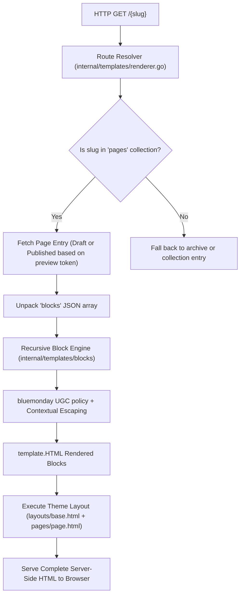

# Go CMS Visual Page Builder & Site Editor — Architecture & Specification

## 1. Executive Summary & Design Principles

The Go CMS Visual Page Builder brings a WordPress Gutenberg–style block editing and site building experience to Go CMS's Templated CMS mode. 

### Key Principles
1. **Zero Second Content Engine**: Builds directly on top of Go CMS's unified Content Engine (`internal/content`), draft/publish engine, optimistic version locking, and RBAC system.
2. **Native Go Server-Side Rendering**: Pages authored in the visual editor compile to structured block trees rendered dynamically using Go's `html/template` engine with `SafeFuncMap` and `bluemonday` UGC sanitization.
3. **Decoupled 3-Panel Visual Editor**: A Gutenberg-inspired React/TypeScript visual builder (Left Inserter Library, Center Responsive Live Canvas, Right Block & Document Inspector) embedded into the Admin Console.
4. **Instant Routability**: Every created page (e.g. `/about-us`) is immediately registered into the dynamic Chi route resolver, rendering server-side HTML without frontend compilation or full rebuilds.
5. **Theme & Template Extensibility**: Supports theme-defined page templates (`default`, `full-width`, `landing`, `canvas`), reusable headers, footers, and global styles.

---

## 2. Codebase Audit & Module Reuse

| Existing Module | Path | Role in Page Builder |
| :--- | :--- | :--- |
| **Content Engine** | `internal/content/` | Manages `pages` collection type, versioning (`draft_data`, `published_data`, `draft_version`, `published_version`), optimistic locking, and draft/publish lifecycle. |
| **Template Engine** | `internal/templates/` | Compiles themes, evaluates layouts (`layouts/base.html`), partials, and page templates with allowlisted `SafeFuncMap`. |
| **Theme System** | `internal/themes/` | Discovers installed themes, parses `theme.json` manifests, resolves assets, and provides layout foundations. |
| **Media Library** | `internal/media/` | Supplies image and media assets to the visual editor via `/api/v1/media`. |
| **RBAC & Auth** | `internal/auth/`, `internal/api/middleware.go` | Enforces permissions for creating, modifying, and publishing pages (`content:pages:create`, `content:pages:update`, `content:pages:publish`). |
| **React Admin** | `admin/src/` | Hosts the Page Builder views (`PagesView.tsx`, `PageBuilderView.tsx`), sidebar navigation, and design system. |

---

## 3. Data Models

### 3.1 Page Document Model (`ContentEntry` for `pages`)

A Page is persisted as a `ContentEntry` belonging to the reserved system collection type `pages`:

```json
{
  "id": "c1f7b029-4a90-48e2-9b7e-953bc965a31a",
  "content_type_uid": "pages",
  "slug": "about-us",
  "status": "published",
  "draft_version": 3,
  "published_version": 2,
  "draft_data": {
    "title": "About Our Team",
    "slug": "about-us",
    "template": "default",
    "header_id": "global",
    "footer_id": "global",
    "seo": {
      "meta_title": "About Our Team | Go CMS",
      "meta_description": "Learn more about our mission, vision, and people.",
      "og_image": "/uploads/team-hero.jpg",
      "canonical": "https://example.com/about-us"
    },
    "blocks": [
      {
        "id": "blk-sec-1",
        "type": "core/section",
        "attributes": {
          "padding": "py-16",
          "backgroundColor": "#f8fafc"
        },
        "children": [
          {
            "id": "blk-cont-1",
            "type": "core/container",
            "attributes": { "maxWidth": "max-w-5xl" },
            "children": [
              {
                "id": "blk-h1-1",
                "type": "core/heading",
                "attributes": { "level": 1, "content": "Empowering Creators with Go", "align": "center" }
              },
              {
                "id": "blk-p-1",
                "type": "core/paragraph",
                "attributes": { "content": "Go CMS combines high-performance Go rendering with modern visual editing.", "align": "center" }
              }
            ]
          }
        ]
      }
    ]
  }
}
```

### 3.2 Block Schema Definition

Every block conforms to the recursive JSON structure:

```typescript
export interface BlockAttributes {
  [key: string]: any;
  content?: string;
  level?: 1 | 2 | 3 | 4 | 5 | 6;
  url?: string;
  alt?: string;
  caption?: string;
  align?: 'left' | 'center' | 'right' | 'justify';
  variant?: 'primary' | 'secondary' | 'outline' | 'ghost';
  columns?: number;
  gap?: string;
  padding?: string;
  margin?: string;
  backgroundColor?: string;
  textColor?: string;
  postType?: string;
  limit?: number;
  layout?: 'grid' | 'list';
}

export interface Block {
  id: string;
  type: string;
  attributes: BlockAttributes;
  children?: Block[];
}
```

### 3.3 Core Block Types

| Block Name | Identifier | Attributes | Allowed Children |
| :--- | :--- | :--- | :--- |
| **Section** | `core/section` | `padding`, `backgroundColor`, `textColor`, `fullWidth` | `core/container`, `core/columns`, any content block |
| **Container** | `core/container` | `maxWidth`, `padding`, `align` | Any block |
| **Columns** | `core/columns` | `columns` (2, 3, 4), `gap`, `stackOnMobile` | `core/column` |
| **Column** | `core/column` | `width`, `padding` | Any block |
| **Heading** | `core/heading` | `level` (1-6), `content`, `align`, `textColor` | None |
| **Paragraph** | `core/paragraph` | `content` (HTML formatted), `align`, `textColor`, `fontSize` | None |
| **Image** | `core/image` | `url`, `alt`, `caption`, `width`, `aspectRatio`, `rounded` | None |
| **Button** | `core/button` | `text`, `url`, `variant`, `size`, `newTab`, `align` | None |
| **Separator** | `core/separator` | `style` (`solid`, `dashed`, `dots`), `color` | None |
| **Spacer** | `core/spacer` | `height` (`sm`, `md`, `lg`, `xl`, custom px) | None |
| **Dynamic Posts** | `core/dynamic-posts` | `collectionUid`, `limit`, `layout` (`grid`, `list`), `showDate`, `showExcerpt` | None |

---

## 4. Server-Side Rendering Pipeline



### 4.1 Block Rendering Engine (`internal/templates/blocks`)

The server-side block engine iterates recursively through the block tree:
1. Matches `block.Type` against registered Go block renderers.
2. Sanitizes user input with `bluemonday.UGCPolicy()`.
3. Ensures link URLs have safe schemes (`http://`, `https://`, `mailto:`, `tel:`).
4. Generates standard HTML elements with clean semantic markup and responsive CSS utility classes.
5. Recursively renders `block.Children` into container blocks (`core/section`, `core/container`, `core/columns`, `core/column`).
6. Returns `template.HTML` for insertion into the page layout template.

### 4.2 Dynamic CMS Content Execution

For `core/dynamic-posts`, the block renderer queries `contentSvc.ListEntries(ctx, collectionUid, filter, previewDraft)` during template execution, injecting real articles or items from the database directly into the rendered HTML.

---

## 5. Visual Editor UI Architecture (3-Panel Gutenberg Design)

```
┌────────────────────────────────────────────────────────────────────────────────────────┐
│ Top Bar: [← Pages]  Page Title: [About Us       ]  [Desktop|Tablet|Mobile]  [Save Draft] [Preview] [Publish] │
├───────────────────┬────────────────────────────────────────────────────┬───────────────┤
│ Inserter Library  │ Live Visual Canvas                                 │ Inspector     │
│ 🔍 Search blocks  │ ┌────────────────────────────────────────────────┐ │ [Block] [Page]│
│ ▾ Text            │ │ Section (py-16, bg-slate-50)                   │ │ Typography    │
│   [Heading]       │ │ ┌────────────────────────────────────────────┐ │ │ Level: H2     │
│   [Paragraph]     │ │ │ Container (max-w-4xl)                      │ │ │ Align: Center │
│ ▾ Media           │ │ │ [H2: Empowering Creators with Go]          │ │ │ Color: #0f172a│
│   [Image]         │ │ │ [P: Build faster websites with Go CMS.]    │ │ ─────────────── │
│ ▾ Layout          │ │ └────────────────────────────────────────────┘ │ │ Spacing       │
│   [Section]       │ └────────────────────────────────────────────────┘ │ Padding: py-16│
│   [Container]     │                                                    │ Background:   │
│   [Columns]       │ + Click to add block                               │ #f8fafc       │
│ ▾ Dynamic         │                                                    │               │
│   [CMS Posts]     │                                                    │               │
└───────────────────┴────────────────────────────────────────────────────┴───────────────┘
```

1. **Top Bar**: Navigation back to page list, inline page title editor, device viewport switch (100% / 768px / 375px), undo/redo stack, status badge, draft save, live preview modal/tab, and publish button.
2. **Left Panel (Inserter)**: Categorized block drawer with search filter. Clicking or dragging an item inserts it into the active selection or end of document.
3. **Center Canvas**: Interactive canvas displaying the blocks styled with theme-faithful CSS. Selecting a block activates a contextual floating toolbar (Move Up, Move Down, Duplicate, Delete) and allows inline editing for headings and text.
4. **Right Panel (Inspector)**: Dual-tab inspector:
   - **Block Tab**: Fine-grained attributes for the selected block (level, typography, alignment, padding, background, image URL, media library picker, dynamic post type selection).
   - **Page Tab**: Page-level settings including slug, layout template selector, SEO metadata (title, description, canonical, OG image), and template part toggles (header/footer).

---

## 6. Route Resolution & SEO Integration

1. **Route Resolution Priority**:
   - `/admin/*` &rarr; Admin SPA.
   - `/api/v1/*` &rarr; REST API.
   - `/uploads/*` &rarr; Media storage.
   - `/` &rarr; Homepage (checks for published page with slug `home` or `homepage`, falls back to `pages/home.html`).
   - `/{slug}` &rarr; Checks `pages` collection for matching slug (e.g. `about-us`). If found and published (or draft with preview token), renders `pages/page.html` with block tree. Falls back to collection archives or single types.
2. **SEO Metadata**:
   - Page SEO fields dynamically populate `<title>`, `<meta name="description">`, `<link rel="canonical">`, `<meta property="og:title">`, and `<meta property="og:image">` in `layouts/base.html`.
3. **Sitemap & Feeds**:
   - Published pages are automatically included in `/sitemap.xml`.

---

## 7. Security & Input Sanitization

- **Bluemonday UGC Policy**: All rich-text or HTML block attributes are filtered through `bluemonday.UGCPolicy()` before server-side rendering, neutralizing XSS, malicious `<script>`, `<iframe>`, or inline javascript event attributes.
- **Protocol Allowlist**: Links, buttons, and image sources are validated against safe schemes (`http`, `https`, `mailto`, `tel`).
- **Contextual Escaping**: Go's native `html/template` auto-escapes all dynamic attributes (classes, IDs, data attributes) ensuring attribute injection cannot escape quoted strings.
- **RBAC**: Handlers enforce user role permissions:
  - `content:pages:read`
  - `content:pages:create`
  - `content:pages:update`
  - `content:pages:delete`
  - `content:pages:publish`

---

## 8. Verification & Test Plan

1. **Unit & Integration Tests**:
   - Block parsing and recursive HTML rendering in Go (`internal/templates/blocks/renderer_test.go`).
   - Template resolution and page rendering with custom templates (`internal/templates/renderer_test.go`).
   - Content persistence and draft/publish lifecycle for pages.
2. **Frontend Quality**:
   - Clean TypeScript compilation (`tsc -b`).
   - Admin test suite execution (`vitest run`).
3. **End-to-End Walkthrough**:
   - Create page `/about-us` via Admin UI.
   - Add Section, Container, Heading ("About Our Team"), Paragraph, and Image blocks.
   - Save as Draft &rarr; Visit `http://localhost:8080/about-us` (verify 404 or draft preview only).
   - Publish page &rarr; Visit `http://localhost:8080/about-us` (verify full server-rendered HTML matches visual editor).

